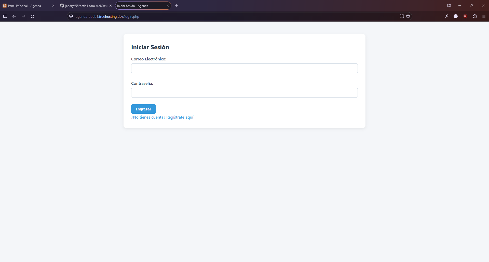
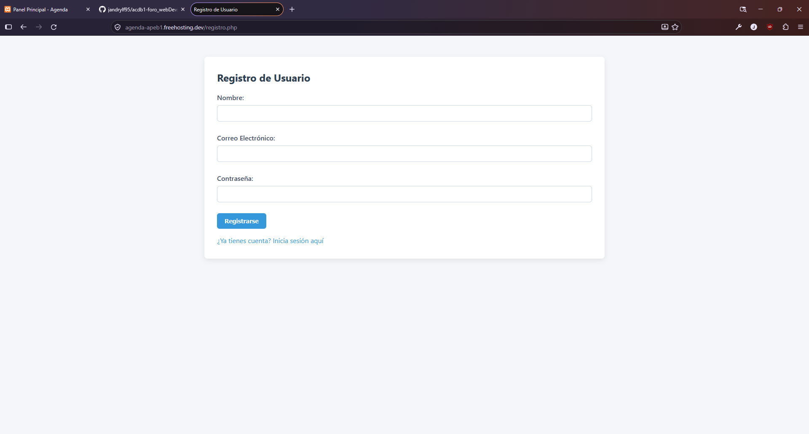
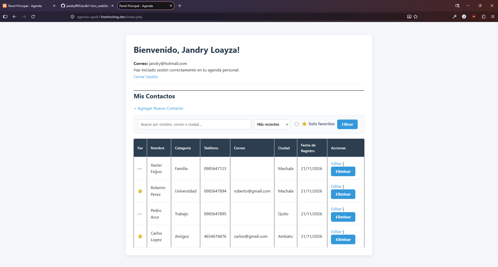

# Agenda Personal - Foro Desarrollo Web (Bimestre 1)

**Autor:** Jandry Loayza Feijoo

---

## 🌐 URL Pública (Despliegue)
La aplicación se encuentra desplegada y accesible en:  
👉 **[https://agenda-apeb1.freehosting.dev](https://agenda-apeb1.freehosting.dev)**

---

## 📌 Descripción del Proyecto
Aplicación web para la gestión de una agenda de contactos personal. Permite registro e inicio de sesión de usuarios, y operaciones CRUD completas (crear, listar, editar y eliminar contactos) con aislamiento de datos por usuario y consultas seguras mediante PDO.

---

## 🚀 Mejoras Respecto a la Versión Anterior
En esta versión se implementaron las siguientes mejoras principales:
* **Búsqueda multicriterio:** Filtrado de contactos por Nombre, Correo o Ciudad en tiempo real mediante `LIKE`.
* **Ordenamiento dinámico:** Posibilidad de ordenar los contactos por más recientes, más antiguos, nombre (A-Z, Z-A) y ciudad, protegido mediante lista blanca en PHP.
* **Gestión de Categorías:** Inclusión de la tabla relacional `categorias` (Familia, Amigos, Trabajo, Universidad, Otro) vinculada con clave foránea y consulta optimizada con `LEFT JOIN`.
* **Contactos Favoritos:** Opción para marcar/desmarcar contactos como favoritos (`⭐`) y filtro para visualizarlos de forma exclusiva.
* **Diseño y estilos:** Integración de `estilos.css` para una interfaz limpia, responsiva y organizada en tarjetas.
* **Conexión adaptable:** Detección automática en `conexion.php` para alternar entre el entorno local (XAMPP) y el hosting de producción sin modificar código.

---

## 🛠️ Tecnologías Utilizadas
* **Lenguaje Backend:** PHP 8.2.12 (PDO, sesiones `$_SESSION`, `password_hash` y `password_verify`)
* **Base de Datos:** MySQL (conexión vía PDO, relaciones de clave foránea)
* **Frontend:** HTML5 y CSS3 (`estilos.css`)
* **Entorno de Servidor:** XAMPP (Local) y FreeHosting (Producción)

---

## 📋 Requisitos para su Ejecución
* Servidor local **XAMPP** (servicios de Apache y MySQL activos).
* PHP 8.0 o superior con extensión `pdo_mysql` habilitada.

---

## 🚀 Pasos para Instalar la Aplicación Localmente

1. **Ubicar el proyecto:**
   Colocar la carpeta `acdb1-foro_webDev` dentro del directorio `htdocs` de XAMPP:
   ```
   C:\xampp\htdocs\acdb1-foro_webDev
   ```

2. **Crear la Base de Datos:**
   * Ingresar a phpMyAdmin (`http://localhost/phpmyadmin`).
   * Crear la base de datos `acdb1-foro_webdev`.
   * Ejecutar el script SQL incluido en el archivo `dataBaseScript.sql`:
   ```sql
   CREATE TABLE IF NOT EXISTS usuarios (
       id_usuario INT AUTO_INCREMENT PRIMARY KEY,
       nombre VARCHAR(100) NOT NULL,
       correo VARCHAR(100) NOT NULL UNIQUE,
       password VARCHAR(255) NOT NULL,
       fecha_registro TIMESTAMP DEFAULT CURRENT_TIMESTAMP
   ) ENGINE=InnoDB DEFAULT CHARSET=utf8mb4;

   CREATE TABLE IF NOT EXISTS categorias (
       id_categoria INT AUTO_INCREMENT PRIMARY KEY,
       nombre VARCHAR(50) NOT NULL UNIQUE
   ) ENGINE=InnoDB DEFAULT CHARSET=utf8mb4;

   INSERT INTO categorias (nombre) VALUES 
   ('Familia'), ('Amigos'), ('Trabajo'), ('Universidad'), ('Otro')
   ON DUPLICATE KEY UPDATE nombre = VALUES(nombre);

   CREATE TABLE IF NOT EXISTS contactos (
       id_contacto INT AUTO_INCREMENT PRIMARY KEY,
       id_usuario INT NOT NULL,
       id_categoria INT NULL,
       nombre VARCHAR(100) NOT NULL,
       telefono VARCHAR(20) NOT NULL,
       correo VARCHAR(100),
       ciudad VARCHAR(50),
       favorito TINYINT(1) DEFAULT 0,
       fecha_creacion TIMESTAMP DEFAULT CURRENT_TIMESTAMP,
       FOREIGN KEY (id_usuario) REFERENCES usuarios(id_usuario) ON DELETE CASCADE,
       FOREIGN KEY (id_categoria) REFERENCES categorias(id_categoria) ON DELETE SET NULL
   ) ENGINE=InnoDB DEFAULT CHARSET=utf8mb4;
   ```

3. **Verificar conexión:**
   Revisar que en [conexion.php](file:///c:/xampp/htdocs/acdb1-foro_webDev/conexion.php) coincidan el puerto (por defecto `3307`), usuario (`root`) y contraseña (`""`).

4. **Acceder a la aplicación:**
   Abrir en el navegador:
   ```
   http://localhost/acdb1-foro_webDev/login.php
   ```

## Capturas de pantalla

### 1 Inicio de sesion


### 2 Registro


### 3 Index
